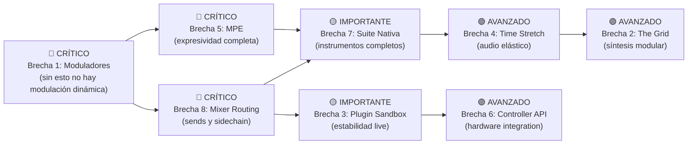

# Análisis de Brechas: Hikaru OpenLive vs. Bitwig Studio

## Objetivo

Mapear con precisión qué tiene Hikaru OpenLive hoy, qué está como stub/placeholder, y qué falta completamente para ser un **clon funcional libre de Bitwig Studio** escrito en Rust + GPUI Kit. La referencia de ingeniería inversa es la arquitectura Java (UI/orquestación) + C++ (DSP/Real-Time) de Bitwig Studio, traducida a Rust idiomático con seguridad de memoria garantizada en tiempo de compilación.

---

## Estado Actual del Codebase (Inventario Real)

> [!NOTE] Esta sección refleja el código real, no el README. Se auditaron ~22.500 líneas de código Rust activo distribuidas en 15 crates.

### ✅ Lo que ya existe y funciona

| Área | Crate / Módulo | Estado |
|:-----|:---------------|:-------|
| Motor de audio CPAL lock-free | `hikaru_audio_engine` (2.728 líneas) | **Implementado** – FTZ/DAZ, soft-clip tanh maestro, fade-in/out por evento, loop por clip |
| Session Matrix (OpenLive) | `hikaru_gui/views/matrix.rs` (2.409 líneas) | **Implementado** – trigger de clips/escenas, cuantización, legato phase-sync |
| Arranger View (OpenStudio) | `hikaru_gui/views/arranger_view.rs` (2.634 líneas) | **Implementado** – tracks, clips en timeline |
| Playlist (OpenStudio) | `hikaru_gui/views/playlist.rs` (3.626 líneas) | **Implementado** – el archivo más grande del proyecto |
| Piano Roll | `hikaru_gui/views/piano_roll.rs` (1.353 líneas) | **Implementado** – notas MIDI, selección marquee, resize, move, drum mode |
| DSP Rack (UI) | `hikaru_gui/views/dsp_rack.rs` (1.852 líneas) | **Implementado** – catálogo nativo, knobs de parámetros, drag-to-set |
| Plugin Host VST3 + CLAP | `hikaru_plugin_host` (wrapper, registry, tap, xlib) | **Implementado** – ventanas embebidas y flotantes en X11 |
| Mixer | `hikaru_gui/views/mixer.rs` (414 líneas) | **Implementado** – volumen, pan, mute, solo, sends |
| State Variable Filter | `hikaru_dsp/effects/filter.rs` | **Implementado** – LP/HP/BP Chamberlin |
| Wavetable Oscillator (básico) | `hikaru_dsp/synth/wavetable.rs` | **Implementado** – interpolación lineal |
| OpenSpectral Phaser | `hikaru_dsp/effects/openspectral_phaser.rs` (360 líneas) | **Implementado** – FFT-based phaser |
| Open Harmonic Processor | `hikaru_dsp/effects/open_harmonic.rs` (119 líneas) | **Implementado** |
| Clip Editor | `hikaru_gui/views/clip_editor.rs` (1.307 líneas) | **Implementado** |
| Waveform Renderer | `hikaru_gui/views/waveform.rs` | **Implementado** – GPU path rendering |
| Sequencer / TrackMatrix | `hikaru_sequencer` | **Implementado** – ClipState, Quantizer, loop, split |
| Transport | `hikaru_transport` | **Implementado** – position, playback state, PPQN |
| MIDI Events | `hikaru_midi` | **Parcial** – MidiMessage básico, controller stubs |
| Formatos de Proyecto | `hikaru_project_file`, `hikaru_openlive_file`, `hikaru_openstudio_file` | **Implementado** – JSON serializable, LGPL |
| MCP Port (IA agents) | `hikaru_mcp`, `hikaru_mcp_port` | **Implementado** |
| CLI + Man Page | `hikaru_cli` | **Implementado** |
| OpenWavetable (UI) | `hikaru_gui/.../hikaru_openwavetable` | **Implementado** |
| OpenDMS (sampler UI) | `hikaru_gui/.../hikaru_opendms` | **Implementado** |
| OpenEQ3 (UI) | `hikaru_gui/.../hikaru_openeq3` | **Implementado** |
| Launchpad Grid (stub) | `hikaru_midi/controllers/launchpad.rs` | **Stub básico** – solo toggle de pad |

---

## Las 8 Brechas Críticas para Completar el Clon de Bitwig

### BRECHA 1 — Sistema Universal de Moduladores (`ModulationBus`)
**Equivalente en Bitwig:** Cada device tiene una "Modulator Bay" con LFOs, ADSRs, Steps, Math, Notes, Expressions, Audio Rate.

**Estado en Hikaru:**
- ❌ No existe ningún `ModulationBus`, `ModulatorEngine`, `LfoProcessor` ni `EnvelopeGenerator` en `hikaru_dsp`
- ❌ La automatización es estática (parámetros se setean una vez desde la UI)
- ❌ No hay mapeo de moduladores a parámetros de plugins externos

**Lo que falta construir:**

```
crates/hikaru_dsp/src/modulation/
├── mod.rs           # ModulationBus trait + registry
├── lfo.rs           # LFO con formas: Sine, Tri, Saw, Square, Sample&Hold
├── envelope.rs      # ADSR, AHR, multi-segment
├── step_seq.rs      # ParSeq-8: secuenciador de pasos de control
├── macro_knob.rs    # 8 macros globales por device
├── math_mod.rs      # Operadores: Add, Mul, Min, Max, Abs
└── audio_rate.rs    # Seguidor de envolvente / side-chain modulator
```

**Complejidad:** Alta — requiere buffer de control por bloque (`control_rate`) interpolado a sample-rate para parámetros de audio-rate.

---

### BRECHA 2 — Motor Modular "The Grid" (`OpenGrid`)
**Equivalente en Bitwig:** Poly Grid + FX Grid — síntesis y procesamiento completamente visual basado en nodos.

**Estado en Hikaru:**
- ❌ No existe ningún `NodeGraph`, `GridEngine`, ni crate `hikaru_grid`
- ❌ `LiveCanvas` existe pero solo como primitiva de render GPU, no como editor de nodos interactivo

**Lo que falta construir:**

```
crates/hikaru_grid/           # [NUEVO CRATE]
├── src/
│   ├── node.rs              # trait DspNode: render(inputs, outputs, sample_rate)
│   ├── graph.rs             # DAG de nodos, orden topológico, sin allocs en hot path
│   ├── nodes/
│   │   ├── oscillators.rs   # Osc (Sine/Saw/Pulse), Wavetable, Noise
│   │   ├── filters.rs       # LP/HP/BP/Notch/Comb — wrappers del SVF
│   │   ├── envelopes.rs     # ADSR, AHR, Ramp
│   │   ├── lfos.rs          # LFO, Random, Clock
│   │   ├── math.rs          # Add, Mul, Clamp, Quantize, Mix
│   │   ├── midi.rs          # Note (pitch/vel/gate), Pressure, Slide
│   │   └── fx.rs            # Delay, Chorus, Reverb (Schroeder/FDN)
│   └── simd.rs              # Bloques vectorizados con `wide` o `pulp`

crates/hikaru_gui/src/views/
└── grid_editor.rs           # [NUEVA VISTA] Editor visual de nodos en GPUI
    # Lienzo con: drag de nodos, cables SVG GPU-accelerated, zoom/pan
```

**Complejidad:** Muy Alta — el grafo de nodos debe ejecutarse en O(n·block_size) sin allocaciones. Los cables necesitan detección de ciclos (rechazarlos) y reordenamiento topológico en cada conexión.

---

### BRECHA 3 — Sandboxing de Plugins Fuera de Proceso (`hikaru_plugin_worker`)
**Equivalente en Bitwig:** `bitwig-plugin-host` — proceso separado por plugin que evita que un crash del plugin crashee el DAW.

**Estado en Hikaru:**
- ⚠️ Plugins cargan **en el mismo proceso** que el motor de audio y la GUI
- ❌ Un segfault en Vital o cualquier VST3 buggy mata todo el DAW
- ❌ No existe `hikaru_plugin_worker` como binario separado

**Lo que falta construir:**

```
crates/hikaru_plugin_worker/  # [NUEVO CRATE — binario standalone]
├── src/
│   ├── main.rs              # Punto de entrada del worker process
│   ├── ipc.rs               # Protocolo IPC: shared memory + SPSC ringbuffers
│   ├── audio_bridge.rs      # Puente audio: worker → motor (lock-free)
│   └── gui_bridge.rs        # Puente GUI: reparenting X11/Wayland cross-process

# En hikaru_plugin_host:
crates/hikaru_plugin_host/src/
├── worker_proxy.rs          # [NUEVO] Proxy que habla IPC con el worker
└── ipc_protocol.rs          # [NUEVO] Mensaje: ProcessBlock, SetParam, ShowGui, Crash
```

**Protocolo IPC sugerido:**
- Audio: `mmap` + `atomic_ring_buffer` (crate `rtrb` o `ringbuf`) — latencia < 10µs
- Comandos: `UnixDatagram` o `pipe` para control (SetParam, ShowGui, Kill)
- GUI: X11 `XReparentWindow(worker_xid, daw_xid)` para embeber ventana cross-process

**Complejidad:** Alta — gestión de ciclos de vida de procesos, IPC de ultra baja latencia, recuperación ante crash (restart del worker sin interrumpir el audio del DAW).

---

### BRECHA 4 — Motor Elástico de Audio (`OpenStretch`)
**Equivalente en Bitwig:** Time-stretching en tiempo real con modos Stretch HD, Beats, Texture, Repitch. Clips de audio se sincronizan al tempo maestro.

**Estado en Hikaru:**
- ⚠️ Los clips de audio se reproducen a velocidad fija (1:1)
- ❌ No existe resampling de tempo ni pitch-preservation
- ❌ No hay integración con ningún algoritmo de time-stretching

**Lo que falta construir:**

```
crates/hikaru_dsp/src/
└── time_stretch/
    ├── mod.rs               # StretchEngine trait + configuración de modo
    ├── repitch.rs           # Resampling simple (sin corrección de pitch)
    ├── wsola.rs             # WSOLA: Waveform Similarity Overlap-Add
    ├── phase_vocoder.rs     # Phase Vocoder con phase-locking
    └── beats_slicer.rs      # Slice en transientes + repitch independiente
```

**Integración en el motor:**
- `AudioClipInstance` necesita un campo `stretch_mode: StretchMode` y `stretch_ratio: f32`
- `AudioEngine::process()` debe llamar al stretcher antes de mezclar el clip
- La GUI necesita mostrar el ratio de stretch en el clip editor y permitir arrastrar el borde del clip para cambiarlo

**Crate candidato:** Wrapper de [`signalsmith-stretch`](https://signalsmith-audio.co.uk/code/stretch/) (C++ via `bindgen`) o implementación pura Rust del WSOLA.

**Complejidad:** Alta — la calidad del stretching es lo que diferencia DAWs. WSOLA es más simple pero audiblemente inferior a Phase Vocoder.

---

### BRECHA 5 — Soporte MPE Completo (`MpeEngine`)
**Equivalente en Bitwig:** MPE nativo en todo el pipeline — cada nota lleva Pressure, Slide, Glide independientes; el Piano Roll los muestra como curvas por nota.

**Estado en Hikaru:**
- ⚠️ `hikaru_midi` solo tiene `NoteOn/NoteOff/CC/PitchBend/SysEx` en `MidiMessage`
- ❌ No hay `MpeNote`, `MpeChannel`, ni protocolo de asignación de canales MPE
- ❌ El Piano Roll no tiene vistas de curvas de expresión per-nota
- ❌ Los plugins CLAP no reciben eventos MPE (aunque CLAP soporta el protocolo)

**Lo que falta construir:**

```rust
// En hikaru_midi/src/mpe.rs [NUEVO]
pub struct MpeNote {
    pub note_id: u32,       // ID único de la nota
    pub channel: u8,        // Canal MPE asignado (1-15)
    pub pitch: u8,
    pub pressure: f32,      // Aftertouch per-note (0.0-1.0)
    pub slide: f32,          // CC74 per-note (timbre vertical)
    pub glide: f32,          // Pitch bend per-note (semitones)
}

pub struct MpeChannelAllocator {
    // Asigna canales MIDI del 2-15 para MPE (canal 1 = master)
    // Lower Zone: canales 2-8 | Upper Zone: canales 9-15
}
```

Y en el Piano Roll (GPUI), agregar:
- Vista de curvas de expresión debajo de la grilla de notas (como en Bitwig)
- Edición de curvas Pressure/Slide/Glide por nota individual

**Complejidad:** Media-Alta — el protocolo MPE está bien especificado (MIDI Assoc.), pero la asignación dinámica de canales y la visualización de curvas por nota en el Piano Roll es UX compleja.

---

### BRECHA 6 — API de Controladores de Hardware (`HikaruControllerAPI`)
**Equivalente en Bitwig:** Controller Scripting API en Java/JavaScript que permite mapear cualquier hardware MIDI (Launchpad, Push, APC40, Behringer X-Touch) con retroalimentación visual bidireccional.

**Estado en Hikaru:**
- ⚠️ `LaunchpadGrid` y `GeneralKeyboard` son **stubs mínimos** (< 50 líneas, sin integración real al motor)
- ❌ No hay API de scripting para controladores
- ❌ `hikaru_midi/src/device.rs` no tiene conexión real a `midir` ni a ningún backend MIDI de OS
- ❌ No hay feedback bidireccional (el DAW no puede iluminar LEDs del Launchpad)

**Lo que falta construir:**

```
crates/hikaru_midi/src/
├── device.rs            # [AMPLIAR] Backend midir real (Linux: ALSA, macOS: CoreMIDI)
├── controller_api.rs    # [NUEVO] Trait HikaruController: on_midi_in, send_feedback
└── mpe.rs               # [NUEVO] Ver Brecha 5

crates/hikaru_controller_runtime/ # [NUEVO CRATE opcional]
├── src/
│   ├── rhai_api.rs      # Scripts Rhai con acceso a transport, clips, params
│   └── wasm_api.rs      # Alternativa WASM con wasmtime (más seguro, más pesado)
```

**Alternativa liviana:** Extender `hikaru_mcp_port` para exponer eventos de transporte y control de clips a scripts externos (el bridge MCP ya existe).

**Complejidad:** Media — el protocolo MIDI es simple; la complejidad está en diseñar la API de scripting y el modelo de eventos bidireccional.

---

### BRECHA 7 — Suite de Instrumentos Nativos Completa

**Estado en Hikaru (lo que existe):**
- ✅ `OpenWavetable` — UI implementada, oscilador básico (interpolación lineal)
- ✅ `OpenDMS` — Sampler de pads (drum machine) con UI
- ✅ `OpenEQ3` — Ecualizador de 3 bandas (UI)
- ✅ `OpenSpectral Phaser` — Efecto phaser FFT (implementado)

**Lo que falta en los instrumentos existentes:**

```
OpenWavetable (ampliar):
├── Múltiples osciladores (hasta 8) con unison y detune
├── Morphing entre wavetables (interpolación por tabla)
├── Modulación de wavetable position por LFO/ADSR (requiere Brecha 1)
├── Sub-oscillator y noise generator
└── Filtro integrado (conectar SVF existente de hikaru_dsp)

OpenDMS (ampliar):
├── Velocity layers (múltiples samples por nota, split por velocidad)
├── Round-robin (rotación aleatoria entre variaciones)
├── Keyzones (rangos de notas por pad)
├── Síntesis granular básica
└── Modulación de punto de loop

Instrumentos nuevos necesarios:
├── OpenPoly — Sintetizador polifónico básico (equiv. Bitwig Poly Synth)
├── OpenDrum — Drum Rack (equiv. Bitwig Drum Machine — celdas independientes con cadenas de FX)
└── OpenSampler — Multisample avanzado (equiv. Bitwig Sampler con keyzones y loops)
```

**Complejidad por instrumento:** Media — el DSP existe (SVF, Wavetable), falta la arquitectura de voz polifónica y las capas de modulación.

---

### BRECHA 8 — Completar el Mixer y el Routing de Audio

**Estado en Hikaru:**
- ✅ Mixer UI básico (volumen, pan, mute, solo)
- ⚠️ `DspSlot.route_destination_id` existe en el formato pero el routing real entre buses no está implementado en el motor
- ❌ No hay routing Mid/Side real en el motor (existe el campo `pan_mode` en el proyecto pero sin lógica DSP)
- ❌ Sends entre tracks no tienen routing real en el motor de audio
- ❌ No hay sidechaining (enviar audio de track A al compresor de track B)

**Lo que falta:**

```rust
// En hikaru_audio_engine/src/lib.rs — ampliar:
struct MixerBus {
    id: usize,
    volume: f32,
    pan: f32,
    pan_mode: PanMode,  // Stereo | MidSide
    sends: Vec<Send>,   // Routing a otros buses
    effects: Vec<DspPluginNode>,
    input_accumulator: [f32; MAX_TRACK_BUF],  // Buffer de suma de inputs
}

// Routing graph: antes del render del bloque, resolver qué buses
// alimentan a cuáles (topological sort) para evitar deadlocks de proceso.
```

---

## Matriz de Prioridad: Qué Implementar Primero



---

## Tabla Comparativa Actualizada: Hikaru vs. Bitwig

| Feature | Bitwig Studio | Hikaru Hoy | Hikaru Objetivo |
|:--------|:-------------|:-----------|:----------------|
| **GUI Framework** | Java (Scene Graph) | GPUI Kit (GPU, Rust) | ✅ Completo |
| **Motor de Audio** | C++ lock-free | Rust lock-free CPAL | ✅ Completo |
| **Session Matrix** | ✅ | ✅ | ✅ |
| **Arranger / Playlist** | ✅ | ✅ | ✅ |
| **Piano Roll** | ✅ completo | ✅ básico | Curvas MPE |
| **DSP Rack** | ✅ | ✅ | ✅ |
| **Plugin Host VST3+CLAP** | ✅ sandboxed | ✅ in-process | Out-of-process |
| **Mixer + Sends** | ✅ | UI ✅ / DSP ⚠️ | DSP completo |
| **Sidechain** | ✅ | ❌ | Implementar |
| **Mid/Side routing** | ✅ | ❌ | Implementar |
| **Moduladores (LFO/ADSR)** | ✅ anidables | ❌ | `ModulationBus` |
| **The Grid (modular)** | ✅ | ❌ | `OpenGrid` |
| **Time Stretch** | ✅ HD+Beats+Texture | ❌ | WSOLA + PV |
| **MPE** | ✅ nativo | ❌ | `MpeEngine` |
| **Controller API** | Java/JS | Stubs | Rhai/WASM |
| **Wavetable Synth** | ✅ avanzado | ✅ básico | Multi-osc + morph |
| **Drum Machine** | ✅ | OpenDMS básico | Velocity layers |
| **Granular** | ✅ | ❌ | OpenSampler |
| **Licencia** | Propietario | AGPL v3 | AGPL v3 |

---

## Preguntas Abiertas / Decisiones de Diseño

> [!IMPORTANT]
> **P1: Orden de implementación** — ¿Empezamos por los Moduladores (Brecha 1, base de todo) o por el Mixer Routing (Brecha 8, que afecta shows en vivo hoy)?

> [!IMPORTANT]
> **P2: Plugin Sandboxing** — ¿El out-of-process plugin host es prioritario ahora para estabilidad en shows en vivo? Tiene alta complejidad de IPC.

> [!IMPORTANT]
> **P3: The Grid** — ¿Querés incluir The Grid en el scope de corto plazo o es un milestone separado (versión 3.0)?

> [!WARNING]
> **P4: Time Stretching** — ¿Se prefiere un wrapper de `signalsmith-stretch` (C++ via bindgen, alta calidad, licencia MIT) o una implementación pura Rust (más trabajo, más alineada con la filosofía del proyecto)?

> [!NOTE]
> **P5: Controller Scripting** — ¿Se usa `rhai` (Rust-native, 0 FFI) o `wasmtime` (más potente, mayor overhead de startup)? También se podría extender el MCP port existente como alternativa.

---

Hecho con **Claude Sonnet 4.6 (Thinking)** en **Google Antigravity**

---