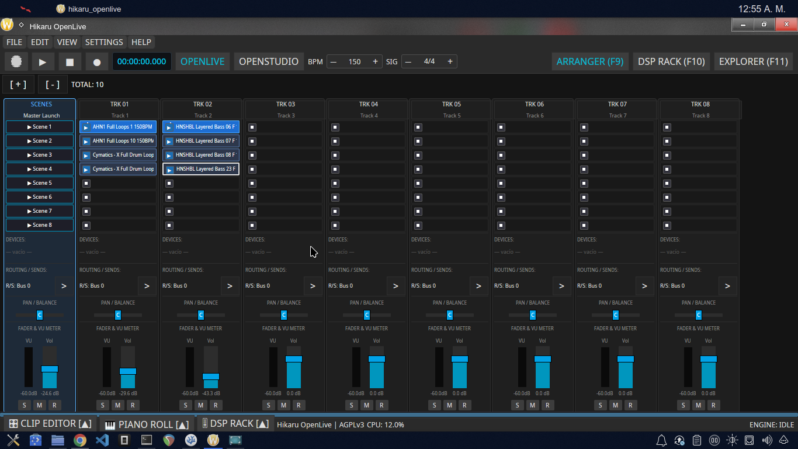
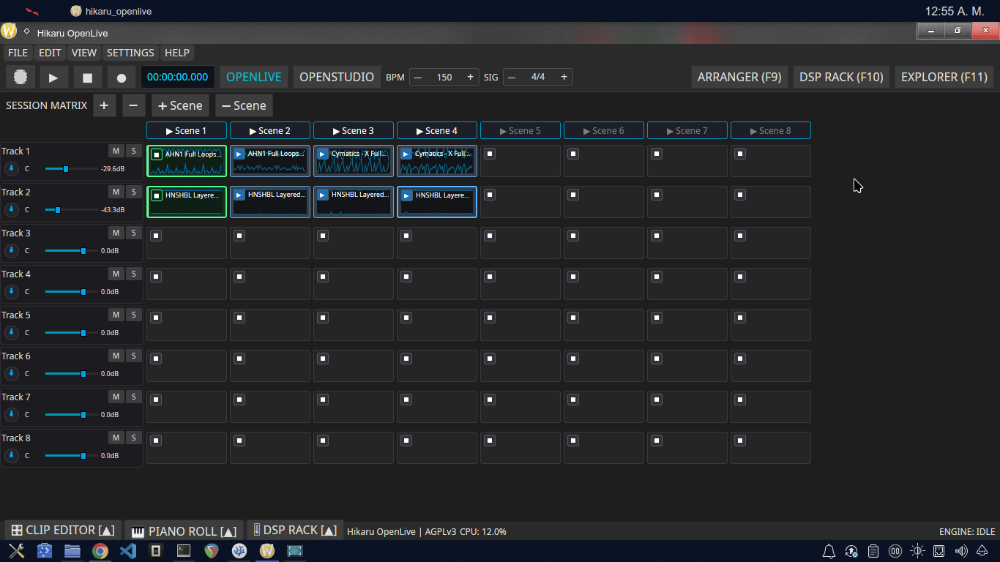
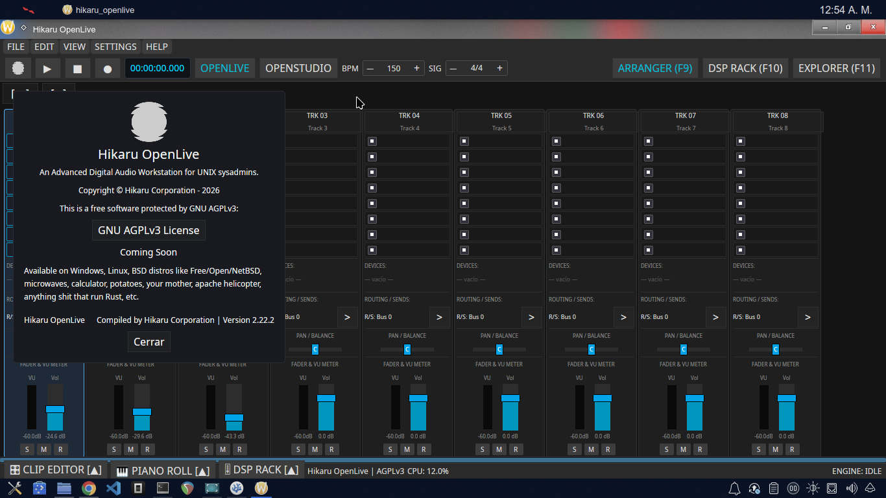
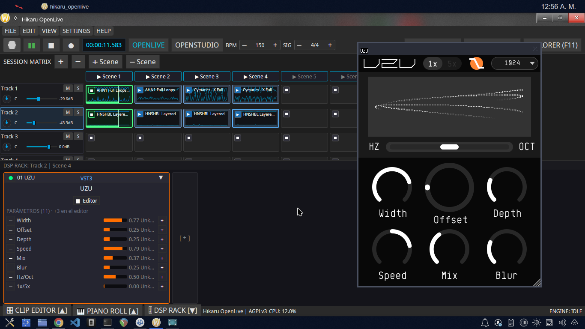

# Hikaru OpenLive

> DAW modular, libre y multiplataforma en Rust para producción musical en vivo y en directo.
> **Alternativa FOSS e independiente a Ableton Live y Bitwig Studio.** *(En desarrollo activo)*

[](https://www.gnu.org/licenses/agpl-3.0)
[](https://www.rust-lang.org)
[](#compilación-rápida-linux--debian--ubuntu)
[](https://github.com/zed-industries/gpui)
[](https://github.com/RustAudio/cpal)

**Hikaru OpenLive** es una estación de trabajo de audio digital (DAW) diseñada para **actuaciones en vivo, lanzamiento de clips en tiempo real y composición lineal**. Construido completamente en Rust, ofrece un motor de audio de ultra baja latencia sin asignaciones de memoria dinámicas en el hilo crítico.

---

## 📸 Vista Previa

### Arranger View

*Línea de tiempo para composición tradicional, edición de pistas y arreglo lineal.*

### Session Matrix

*Grilla de clips al estilo Ableton/Bitwig para disparo cuantizado de escenas y waveforms en tiempo real.*

### Acerca de

*Información del proyecto, créditos y enlaces.*

### Host de Plugins VST3 / CLAP (Experimental/Beta)

*Carga y gestión de plugins de terceros en formato VST3 y CLAP.*

---

## 🚀 Características Principales

- **Session Matrix (Live Workflow):** Lanzamiento de clips por escenas, cuantización rígida y triggers instantáneos.
- **Arranger View:** Edición en línea de tiempo paralela a la matriz de sesión.
- **Motor de Audio sin Bloqueos:** Hilo de audio en tiempo real impulsado por CPAL y secuenciador sample-accurate.
- **DSP & Sintesis Nativa:** Racks de efectos (filtros, flanger, phaser) y generador wavetable integrado.
- **Host VST3 / CLAP:** Integración experimental para instrumentos y efectos externos.

---

## 🧭 Dirección del Proyecto: Ingeniería Inversa a Bitwig Studio

Hacemos un **llamado de atención** a la comunidad de audio open-source: el objetivo del **Hikaru OpenLive** es realizar una **ingeniería inversa de Bitwig Studio**.

¿Por qué Bitwig? Porque la falta de programas **libres y de código abierto (FOSS)** que permitan **"loopear"** como los privativos — Ableton Live y Bitwig Studio — y sobre todo no hay un programa libre que se acerque a Bitwig, que tiene el workflow de live looping / session view / clip launching más profundo del mundo.

Ableton y Bitwig perfeccionaron los workflows de looping en vivo, clip launching y performance en tiempo real, y la comunidad open-source no pudo alcanzarlos. **Hikaru OpenLive es nuestra respuesta**: un DAW libre y open-source construido para hacer **ingeniería inversa** sobre esos workflows privativos y re-implementarlos desde cero en Rust — session matrix, arranger, DSP, motor realtime — sin depender de nada de código cerrado.

Si querés ayudarnos a darle forma a esa dirección: esta es la **north star**. 🚀

### Bitwig está haciendo obsolescencia programada

**Bitwig está practicando obsolescencia programada sobre ciertos procesadores de Intel** (como el mío actual, un i3-3110m).

El punto: **Hikaru OpenLive no exige un procesador de la NASA** y **no cuesta un carajo**, mientras que **Bitwig sale tres hipotecas, un huevo y la mitad del otro**, y encima, aunque gastes toda tu guita en una licencia de Bitwig, **ellos pueden revocarte la licencia en cualquier momento** (legalmente, no es tuya).

Además, Bitwig utiliza los **sets de instrucciones** (como AVX1 y AVX2, y los que sean) como excusa para **prohibirte usar Bitwig en un procesador "viejo"**.

---

### 🔧 Ingeniería Inversa Aceptada: Ghidra, REA y el Puerto MCP del Hikaru OpenLive

La **ingeniería inversa** de software propietario está **explícitamente aceptada** acá. Aceptamos:

* **Ghidra** — la suite de ingeniería inversa open source.
* **REA** — nuestro pipeline de ingeniería inversa (OpenCode + Frida/Ghidra) para entrar a binarios cerrados.
* **El propio puerto MCP del Hikaru OpenLive** — el puente que convierte código legacy cerrado (C/C++, JUCE, Steinberg SDK) en pseudocódigo en Rust legible que agentes de IA (Claude Code, OpenCode, Cursor, Kimi Code, Google Antigravity, etc.) pueden consumir.

Aplicado a plugins propietarios como **Serum 1 y 2**, **reFX Nexus**, **UZU (spectral phaser propietario)** y otros instrumentos/efectos legacy escritos en C/C++, para que ese conocimiento se convierta en **software libre y de código abierto** (Rust) para toda la comunidad — bajo los mismos términos AGPLv3.

### Puerto MCP del Hikaru OpenLive

El **puerto MCP del Hikaru OpenLive** no es solo para ingeniería inversa: también sirve para **conectar el Hikaru OpenLive a agentes de IA** como **Claude Code, OpenCode** o cualquier IA agéntica por CLI.

También sirve para **desarrollo**: analizar bugs, agregar features, refactorizar, etc.

Y a futuro, para **producir música**: por ejemplo, que **Google Antigravity** (por tirar un ejemplo) te genere un archivo **Hikaru OpenStudio File (`.opsf`)** con todos los samples, audio clips y MIDI clips bien puestos, con estructura y todo.

Esto es **mil veces mejor que Suno/Udio**, que no saben hacer un tema de dubstep como la gente: llenos de artefactos y ruidos blancos autopercebidos como growls y basses grosos. Basta de ese mamarracho para el Bass Music (Dubstep, Future Riddim, Hi-Tech, Future Bass, etc.). Con el Hikaru OpenLive + un agente de IA, el control es total y el resultado es real.

---

## 🛠️ Compilación Rápida (Linux)

```bash
# Dependencias base (Debian/Ubuntu)
sudo apt update && sudo apt install -y build-essential pkg-config git libasound2-dev libx11-dev libgl1-mesa-dev

# Clonar y ejecutar
git clone https://github.com/hikarucorporation/hikaru-openlive.git
cd hikaru-openlive
cargo run --release -p hikaru_gui

```

## 🛠️ Compilación para un Release Completo (Linux)

En la carpeta raíz de tu proyecto (ej; `/miyu-shrine-workspace/*`)

```bash
cargo build --release --bin hikaru_openlive
```

### Crear un ejecutable `release-debug`

```bash
cargo run --profile release-debug -p hikaru_gui
```

---

## Compilación Cruzada para Windows (Cross-compilation)

Hikaru OpenLive puede compilarse directamente desde Linux para generar el ejecutable nativo de Windows (`.exe`) utilizando el target GNU de Rust.

### Requisitos previos

Asegurate de tener instalado el toolchain y el linker cruzado en Debian/Ubuntu:

```bash
# Instalar el toolchain de Rust para Windows x86_64
rustup target add x86_64-pc-windows-gnu

# Instalar el compilador MinGW-w64
sudo apt update && sudo apt install gcc-mingw-w64-x86-64

```

### Compilación

Para generar el ejecutable optimizado de producción:

```bash
cargo build --release --target x86_64-pc-windows-gnu -p hikaru_gui

```

El binario resultante se encontrará en:
`target/x86_64-pc-windows-gnu/release/hikaru_gui.exe`

### Pruebas en Linux (Wine)

Podés probar el ejecutable `.exe` directamente usando Wine:

```bash
wine target/x86_64-pc-windows-gnu/release/hikaru_gui.exe
```

---

### 🗺️ Roadmap & Próximos Pasos: Ingeniería Inversa a Bitwig (legacy Java/C++ → Rust)

1. **Clip Launcher (Session Matrix)**: disparo cuantizado de escenas, lanzamiento de clips y waveforms en tiempo real — el workflow en vivo más profundo de Bitwig. **[EN CURSO]**
2. **Playlist**: arreglo de clips, escenas, follow actions, looping — el lado de session view de Bitwig.
3. **Vistas Arrange / Mix / Edit**: línea de tiempo lineal, consola de mixer, vista de edición — layout, paneles y posición de botones reverse-engineered.
4. **Piano Roll & editor MIDI**: edición de notas, clips y control rítmico. **[EN CURSO]**
5. **Mixer & DSP rack**: canales, filtros, flanger, phaser, wavetable/espectral — desde instrumentos propietarios. **[EN CURSO]**
6. **Ingeniería inversa de plugins propietarios**: Serum 1 y 2, reFX Nexus, UZU (spectral phaser) — convertir legacy C/C++/JUCE a Rust. **[EN CURSO]**
7. **Clips de automatización**: estilo Bitwig/FL Studio, modulación en tiempo real.
8. **Hardware & MIDI mapping**: controladores, input físico, timestretching en tiempo real, arreglos de bugs.
9. **UI por GPU (gpui-kit)**: mantener el look & feel de DAW propietario con software libre y open source. **[LISTO]**

---

## 👥 Comunidad y Colaboradores

Estamos **buscando contribuyentes** para seguir impulsando el desarrollo de **Hikaru OpenLive**! 🙌

Un agradecimiento especial a los gordos contribuyentes y a la comunidad de software libre que apoyan el desarrollo de **Hikaru OpenLive**:

* **Contributors:** [Ver lista de contribuyentes directos](https://github.com/hikarucorporation/hikaru-openlive/graphs/contributors)
* **Forks y derivados:** [Explorar forks de la comunidad](https://github.com/hikarucorporation/hikaru-openlive/network/members)

Creadores:

* [Hikaru Corporation](https://github.com/hikarucorporation)
* [DTG](https://github.com/doujintechnologicsgroup)
* [OpenCode 🤖 ](https://github.com/opencode-agent)

### 🤝 Se Buscan Contribuyentes de Código

Estamos en la búsqueda activa de **nuevos contribuyentes** para el código en **Rust** de **Hikaru OpenLive**! Si querés meterte al motor de audio en tiempo real, al Rust sin bloques, al DSP, al rendering GPU o a la integración de hardware — esta es tu invitación.

* **¡Los Pull Requests son más que bienvenidos!** (Soporte MIDI, controladores físicos, timestretching y arreglos de bugs son prioridad total).

### 🤖 Issues Asistidas por IA: Con o Sin Agentes

**Aceptamos todo tipo de issues**, ya sean escritas por un humano o generadas con la ayuda de un agente de IA como:

* Claude Code
* OpenCode
* Cursor
* Kimi Code
* Google Antigravity
* ...o cualquier otro agente de IA que prefieras (Codex, Gemini CLI, Qwen Code, DeepSeek, Copilot, etc.).

Eso incluye bugs, feature requests, reproducciones y Pull Requests — **con o sin agentes de IA**. Si un agente de IA te ayudó a detectar, reproducir o incluso arreglar algo, **abrí el issue igualmente**: los hallazgos, logs o propuestas del agente son más que bienvenidos. Los issues escritos por humanos son igual de válidos y siempre se aceptan.

No dudes y no filtres: abrí el issue como se haya creado. Si es válido, es válido. 🚀

## Licencia

Este programa es software libre bajo los términos de la **GNU Affero General Public License (AGPLv3)**. Ver [`LICENSE`](https://www.gnu.org/licenses/agpl-3.0.en.html) para más detalles.

Las librerías de formato de archivo y de drivers de audio (`hikaru_project_file`, `hikaru_openlive_file`, `hikaru_openstudio_file`, `hikaru_audio_drivers`) son **LGPL-3.0-or-later** para que DAWs de terceros las puedan usar sin abrir el motor. El texto de la licencia está en [`LICENSE-LGPL-3.0`](LICENSE-LGPL-3.0).

El proyecto vendoriza tres crates de terceros con sus propias licencias: `gpui-pre` / `gpui-pre-linux` (Zed, **Apache-2.0** upstream, relicenciado acá a **LGPL-3.0-or-later**) y `vst3-host` (**MIT** upstream, relicenciado acá a **LGPL-2.1-or-later**). El mapa completo de licencias y los `NOTICE` por crate están en [`docs/licencias.md`](docs/licencias.md).

---

### 🛡️ Nota sobre el Desarrollo y Licencia (GNU AGPLv3)

A los de la comunidad que lloran *"AI Slop"* solo por usar LLMs/OpenCode para traducir arquitectura y visión de diseño a código funcional en Rust: 

> **Hikaru OpenLive / OpenStudio es 100% Software Libre bajo la licencia GNU AGPLv3.** (como dice anteriormente arriba)

Esto significa que:
1. Podés usarlo, estudiarlo, modificarlo, redistribuirlo e incluso comercializarlo o montarlo en servicios Cloud.
2. **NO SEAS RATA:** Si utilizás código de Hikaru OpenLive para un servicio en la nube (tipo Ableton Cloud, FL Studio Web, Splice o plataformas SaaS), la AGPLv3 te **exige explícitamente liberar el código fuente de tus modificaciones** a la comunidad.
3. No hace falta que liberes la infraestructura privativa de tu servidor, pero **CUALQUIER cambio, wrapper, binding a nivel kernel/OS o adaptación del motor de Hikaru OpenLive DEBE SER PUBLICADO** bajo la misma licencia. La tivoización y el código cerrado en la nube están estrictamente prohibidos.

Si no entendiste cómo funciona el software libre bajo AGPLv3 ni cómo la inteligencia artificial se usa como un compilador de ideas de alto nivel... la culpa no es del código, es tuya como sysadmin irresponsable XD. 🚀

---