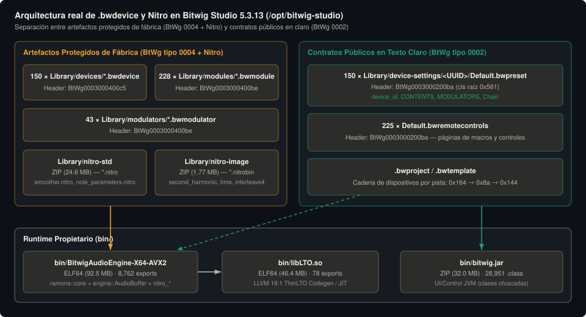
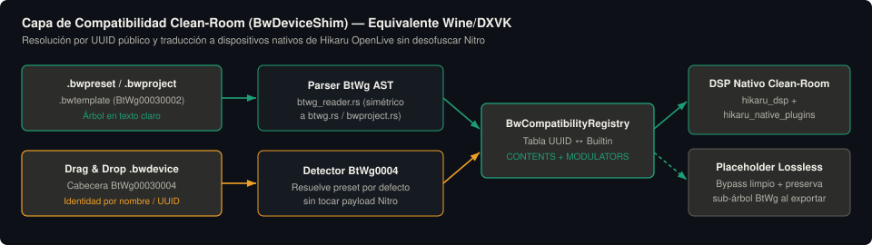

# Análisis con REA de `.bwdevice` (Bitwig Studio 5.3.13) y Arquitectura de Compatibilidad tipo Wine/Proton para Hikaru OpenLive

> [!IMPORTANT]
> **Hallazgo central (Observación estática con REA):** Un archivo `.bwdevice` **no es un binario nativo ELF/PE** (como un `.exe`, `.vst3` o `.clap`), ni contiene código máquina `x86_64`. Es un contenedor `BtWg` de **tipo `0004`** (variante ofuscada/protegida del serializador `ramona::core`) cuyo DSP interno está definido como grafos modulares **Nitro** (`*.nitro` / `*.nitrobin`) que `BitwigAudioEngine-X64-AVX2` compila en tiempo de ejecución mediante **LLVM 19.1 ThinLTO (`libLTO.so`)**.
>
> Sin embargo, **todo el contrato público de cada dispositivo** (su `UUID` canónico, nombre, categoría, topología `audio_to_audio` / `note_to_audio` / `note_to_note`, IDs exactos de parámetros `CONTENTS`, slots `MODULATORS`, cadenas anidadas y `Default.bwremotecontrols`) **se almacena sin cifrar en formato `BtWg00030002`** tanto en `/opt/bitwig-studio/Library/device-settings/<UUID>/Default.bwpreset` como dentro de `.bwpreset`, `.bwproject` y `.bwtemplate`.

---

## 1. Arquitectura real descubierta con REA en `/opt/bitwig-studio`

### 1.1 Comparativa binaria: `BtWg` Tipo `0002` (Público) vs Tipo `0004` (`.bwdevice`)

Mediante el análisis de entropía por bloques de 256 bytes en REA e inspección de cabeceras sobre la instalación local `/opt/bitwig-studio` (Bitwig Studio 5.3.13, rev `161983`):

| Característica | `.bwpreset` / `.bwproject` / `.bwtemplate` | `.bwdevice` / `.bwmodule` / `.bwmodulator` |
|---|---|---|
| **Cabecera ASCII (42 B)** | `BtWg0003` + **`0002`** + `00ba` (`00b8` en 5.1) + `body_offset` | `BtWg0003` + **`0004`** + `00c5` (devices) / `00be` (modules/modulators) + `body_offset` |
| **Sección `meta` (`0x2a..~0x300`)** | **Sin cifrar** (`cls = 4`, entropía `4.27–4.47`). Pares clave-valor legibles (`device_id`, `device_name`, `device_type`, etc.). | **Ofuscada/protegida** (entropía `6.82–7.20`). Mantiene longitud idéntica (~539–732 bytes) pero con flujo enmascarado. |
| **Padding reservado (`~0x300..body_offset`)** | **Texto claro:** ~4,864 bytes de espacios ASCII `0x20` terminados en `\n` (`0x0a`), **entropía `0.0000`**. | **Texto claro idéntico:** ~4,608–4,864 bytes de espacios `0x20` + `\n`, **entropía `0.0000`** (`DC Offset.bwdevice` offsets `768..5632`). |
| **Cuerpo (`body_offset..EOF`)** | **Árbol binario `BtWg` en claro** (entropía `3.00–4.04`). Raíz `cls = 0x561` en `.bwpreset` o `0x2e` en `.bwproject`. | Prefijo `0x00` + cabecera de 32 bytes + payload protegido/comprimido (entropía `7.12–7.68`, con bloques `zlib` `0x789c`/`0x78da` en dispositivos grandes como `Amp.bwdevice`). |
| **Propósito arquitectónico** | Persistir el **estado público e interoperable** de una instancia (UUID, valores de parámetros, moduladores, ruteo, macros y cadenas). | Empaquetar la **definición interna de fábrica** (grafo DSP Nitro y layout interno del dispositivo). |

### 1.2 Cómo ejecuta Bitwig el DSP internamente (`ramona` + `Nitro` + `LLVM 19.1`)

La inspección estática de símbolos exportados y secciones ELF en REA sobre `BitwigAudioEngine-X64-AVX2` (`92,506,336` bytes) y `libLTO.so` (`46,391,888` bytes) demuestra tres subsistemas clave (**observaciones directas**):

1. **Modelo de objetos y serializador `BtWg` (`ramona::core`):**
   - Símbolos observados: `ramona::core::ClassDefinition::readObject(..., ramona::io::SerializationFormat*)`, `ramona::core::ClassDefinition::getAttributeDefinitions()`, `ramona::core::ModelObject::setWriteInfoId(int)` (asignación del `obj_id` 1-based DFS documentado en [btwg.rs](../../../crates/hikaru_gui/src/project/btwg.rs)), `ramona::core::ObjectManager`.
2. **Motor vectorial y primitivas `Nitro` (`engine` + `nitro_*`):**
   - Símbolos C/C++ observados en `BitwigAudioEngine-X64-AVX2`: `nitro_window_fill_buffer_1024`, `nitro_window_fill_buffer_4096`, `nitro_fft_backward_512`, junto con `engine::AudioBuffer` parametrizado por ancho SIMD (`<1>`, `<2>`, `<4>`, `<8>`).
   - Librerías estándar acompañantes en `Library/`: `nitro-std` (ZIP con fuentes/módulos `.nitro` como `smoother.nitro` y `note_parameters.nitro`) y `nitro-image` (ZIP con bitcode precompilado `.nitrobin` como `nonlinear/second_harmonic.nitrobin`, `signal/audio_hysteresis.nitrobin`, `signal/lrms.nitrobin`, `interleave/interleave4.nitrobin`).
3. **Compilación JIT / ThinLTO en tiempo real (`bin/libLTO.so`):**
   - `libLTO.so` exporta 78 símbolos de **LLVM 19.1** (`LLVM_19.1`, `thinlto_create_codegen`, `lto_module_create_from_memory`, `thinlto_codegen_process`, `thinlto_module_get_object`, `lto_codegen_optimize`).
   - **Inferencia técnica respaldada por evidencia:** Cuando Bitwig instancia un `.bwdevice` o arma un patch de *The Grid* (`.bwmodule`), fusiona los módulos `.nitro`/`.nitrobin` en memoria y usa LLVM ThinLTO para compilar el grafo modular a código nativo AVX2/SSE4.1 sin overhead de llamadas virtuales por sample.

---

## 2. Por qué la analogía con Wine/Proton cambia de capa (y cómo hacerla 100% legal y clean-room)

> [!CAUTION]
> **Límite clean-room y de licencias (AGPLv3 / LGPLv3):** Desofuscar el payload `BtWg00030004` de los `.bwdevice` de fábrica o extraer/traducir el código propietario `*.nitro` violaría el aislamiento *clean-room* del proyecto (documentado en [bitwig-5.3.13-parity-audit.md](../bitwig-5.3.13-parity-audit.md#L184-L189)). **Tampoco es necesario** para lograr la experiencia de *"abrir un dispositivo/preset de Bitwig en Hikaru como Wine"*.

En **Wine / Proton** existen dos mecanismos distintos:
1. **Ejecución de código PE de terceros (`user.exe`):** Carga instrucciones `x86_64` del ejecutable. No aplica a `.bwdevice` porque `.bwdevice` no contiene código `x86_64` ni existen `.bwdevice` compilados por terceros fuera de Bitwig.
2. **DLLs `builtin` de Wine (`WINEDLLOVERRIDES=d3d11,xaudio2_7=b` / DXVK):** Cuando un juego o proyecto pide `d3d11.dll` o instancia un `CLSID`/`UUID` del sistema con parámetros públicos, Wine **no desencripta ni ejecuta el binario de Microsoft**: intercepta el identificador público (`UUID` / nombre de DLL) y lo redirige a una **reimplementación nativa clean-room** que respeta exactamente la misma tabla de parámetros, puertos de E/S y estados serializados.

### El contrato público `BtWg00030002` que ya tienes disponible en claro

En `/opt/bitwig-studio/Library/device-settings/<UUID>/Default.bwpreset` existen **150 archivos `BtWg0003000200ba` completamente en texto claro** (uno por cada `.bwdevice` nativo), más **225 `Default.bwremotecontrols`**. Cada uno expone públicamente:

- **En `meta` (`cls = 4`):**
  - `device_id`: UUID canónico (ej. `01af068e-1e49-4777-a6e6-7f1dc679227a` = `EQ-2`, `01c7c48f-40cd-40cd-8a9a-1f258f1cc7d5` = `Audio MOD`, `061dcec6-543f-46f6-b679-f092eeefdbe4` = `Tilt`, `0815cd9e-3a31-4429-a268-dabd952a3b68` = `Note Transpose`, `20b72dbc-0fe1-47c5-867c-f0ab1510f723` = `Test Tone`, `20e18780-8438-48d3-b234-40dcbaa947b8` = `Comb`, `252723bf-68a6-4ee6-81f8-95ba4d0fb467` = `Phase-4`, `264d6f4e-5067-46c9-a4fa-a75a295d9e01` = `Note Grid`).
  - `device_name`, `device_category`, `device_type` (`audio_to_audio` | `note_to_audio` | `note_to_note`).
  - `referenced_device_ids`, `referenced_modulator_ids`, `referenced_module_ids`, `referenced_packaged_file_ids`.
- **En `body` (`cls = 0x561`):**
  - `CONTENTS`: nombres públicos exactos de cada parámetro (ej. en `EQ-2`: `LO_GAIN`, `LO_FREQ`, `LO_Q`, `TYPE1`, `LO_ENABLE`, `HI_TYPE`, `HI_FREQ`, `HI_GAIN`, `HI_Q`, `HI_ENABLE`; en `Note Transpose`: `COARSE`, `FINE`, `OCTAVES`) con sus tipos y valores por defecto.
  - `MODULATORS`: bahía de moduladores conectados a objetivos mediante `obj_key` (`tag = 0x1a`).
  - Sub-cadenas recursivas (`FX`, `Chain`) en contenedores como `Audio MOD`, `Multiband FX-2` o `Wet FX`.

---

## 3. Diseño del "Proton/Wine Layer" (`BwDeviceShim`) en Hikaru OpenLive

### Mapeo directo a lo que Hikaru OpenLive ya tiene implementado

Hikaru OpenLive ya cuenta con equivalentes nativos en [crates/hikaru_dsp/src/effects/](../../../crates/hikaru_dsp/src/effects) y [dsp_rack.rs](../../../crates/hikaru_gui/src/views/dsp_rack.rs#L42-L133) que pueden actuar inmediatamente como las **"Builtin DLLs"** de tu capa Wine:

| Dispositivo Bitwig (`.bwdevice` / `UUID`) | Implementación Clean-Room actual en Hikaru | Rol en `BwDeviceShim` |
|---|---|---|
| `Bit-8` | [bit8.rs](../../../crates/hikaru_dsp/src/effects/bit8.rs) + `hikaru_bit8` (con `wet_fx_chain`) | Mapeo 1:1 de parámetros `CONTENTS` + cadena `Wet FX` |
| `DC Offset` | [dc_offset.rs](../../../crates/hikaru_dsp/src/effects/dc_offset.rs) | Mapeo directo |
| `Tool` | [tool.rs](../../../crates/hikaru_dsp/src/effects/tool.rs) | Mapeo de ganancia, width, pan e inversión de fase |
| `Dual Pan` | [dual_pan.rs](../../../crates/hikaru_dsp/src/effects/dual_pan.rs) | Mapeo directo |
| `Test Tone` | [test_tone.rs](../../../crates/hikaru_dsp/src/effects/test_tone.rs) | Mapeo de frecuencia, nivel y forma de onda |
| `Time Shift` | [time_shift.rs](../../../crates/hikaru_dsp/src/effects/time_shift.rs) | Mapeo de retardo en ms/samples |
| `Tremolo` / `Ring-Mod` | [tremolo.rs](../../../crates/hikaru_dsp/src/effects/tremolo.rs) / [ring_mod.rs](../../../crates/hikaru_dsp/src/effects/ring_mod.rs) | Mapeo directo + sync con `HostTransportInfo` |
| `Phaser+` / `Freq Shifter+` | [phaser_plus.rs](../../../crates/hikaru_dsp/src/effects/phaser_plus.rs) / [freq_shifter_plus.rs](../../../crates/hikaru_dsp/src/effects/freq_shifter_plus.rs) | Mapeo de modos y parámetros normalizados |
| `Comb` (`20e18780-...`) | [ultracomb.rs](../../../crates/hikaru_dsp/src/effects/ultracomb.rs) | Mapeo de frecuencia, feedback y polaridad |
| `EQ-2` / `EQ-5` / `EQ-DJ` | `hikaru_openeq3` | Adaptación de bandas (`LO_GAIN`, `LO_FREQ`, `HI_GAIN`, `HI_FREQ`) |
| `Polymer` / `Polysynth` | `hikaru_openpoly` | Síntesis sustractiva / wavetable |
| `Drum Machine` / `Sampler` | `hikaru_opendms` / `hikaru_sampler` | Pads y sample pool (`0xd3c`) |
| `Poly Grid` / `FX Grid` / `Note Grid` | `hikaru_opengrid` (97 módulos implementados) | Traducción del grafo público de `.bwpreset` (`referenced_module_ids`) a nodos de `OpenGrid` |
| 43 Moduladores (`LFO`, `ADSR`, `Macro`...) | `hikaru_openmodulation` (43/43 listos) | Vinculación del bloque `MODULATORS` (`0x1a` `obj_key`) al bay del slot en `dsp_rack.rs` |
| Dispositivos aún no implementados | `PassthroughPlaceholderShim` (nuevo) | Preserva en memoria el sub-árbol `BtWg` intacto, muestra los knobs de `CONTENTS` en la tarjeta del rack en modo lectura/bypass limpio y permite re-exportar a `.bwproject`/`.bwtemplate` sin pérdida (*round-trip lossless*). |

### Hoja de ruta técnica para cubrir las 5 features `bd-01..bd-05` de `features_bitwig.json`

1. **`bd-01` — Parser AST completo de `BtWg` (`crates/hikaru_gui/src/project/btwg_reader.rs`):**
   - Hoy [bwproject.rs](../../../crates/hikaru_gui/src/project/bwproject.rs#L805-L1039) escanea patrones puntuales (`0x2c8`, `0x15b`, `0x286`). Construir el lector recursivo simétrico a `BtWgWriter` ([btwg.rs](../../../crates/hikaru_gui/src/project/btwg.rs#L108-L320)) que reconstruya la tabla de objetos 1-based DFS (`tags 0x01..0x1a`) para documentos `BtWg00030002` (`.bwpreset`, `.bwremotecontrols`, `.bwproject`), y que ante una cabecera `BtWg00030004` (`.bwdevice`) identifique limpiamente el artefacto por su nombre/metadatos públicos y cargue su estado inicial por defecto sin tocar el payload protegido.
2. **`bd-02` — Tabla `BwCompatibilityRegistry` + traductor de parámetros `CONTENTS` y `Default.bwremotecontrols`:**
   - Mapear `(UUID, param_name, bitwig_raw_value)` al espacio normalizado `0.0..=1.0` de [`PluginInstance`](../../../crates/hikaru_plugin_host/src/lib.rs#L218-L350) y los estados de `dsp_rack.rs`.
3. **`bd-03` — Ruteo de `MODULATORS` hacia `hikaru_openmodulation`:**
   - Resolver las tuplas `obj_key` (`0x1a`) de moduladores hacia los parámetros del slot correspondiente en `dsp_rack.rs`.
4. **`bd-04` — Cadenas anidadas (`Chain`, `FX Layer`, `Wet FX`, `Multiband`):**
   - Mapear recursivamente listas de dispositivos hijos (`0x144` / `FX` `Chain`) aprovechando la infraestructura existente de `wet_fx_chain` en `dsp_rack.rs`.
5. **`bd-05` — Carga de presets de Grid y soporte en Browser (`.bwpreset` + `.bwdevice`):**
   - Añadir `.bwpreset` y `.bwdevice` en `popup_browser.rs` / `explorer.rs` y traducir patches de `Poly Grid` / `FX Grid` / `Note Grid` guardados en `.bwpreset` hacia `hikaru_opengrid`.

---

## 4. Registro de Evidencia REA, Cobertura y Límites

| Artefacto / Operación | Evidence ID de REA | Tipo / Confianza | Alcance e Incógnitas preservadas |
|---|---|---|---|
| Inventario `/opt/bitwig-studio` (4,350 entradas) | `ev_95c5908212bc432cc066ef508ad2336c89810d07c46d3f37cb296f8b26293004` (padre `ev_a24216d62d5c92b8ebd566906a211ad13d48e37a73e1a7d799107bf5b6b83c12`) | `observed` / `derived` (estático) | Inventario completo de los 150 `.bwdevice`, 228 `.bwmodule`, 43 `.bwmodulator`, 150 `Default.bwpreset`, `nitro-std` y `nitro-image`. No observa ejecución en vivo. |
| Entropía de `Amp.bwdevice` (57,700 B) | `ev_80dfe7373bb790d2fe2a83a15c0aa40e4f5d13263b4dfc474c847a80370d14d5` (padre `ev_63f99ff50bcc7213c3718e3aac6ea2907405e828cd1e8e4057543ef0ccb6978f`) | `observed` | Entropía global `7.6845`; bloque de alta entropía desde offset `8192` (`49,508` B). |
| Entropía fina (256 B) de `DC Offset.bwdevice` (7,813 B) | `ev_0933f6d4403fd765a621e6a43147c3887c3284fccd3f1ebce034ed63360f3cf9` | `observed` | Confirma meta ofuscada (`0..768`, entropía `6.82–7.20`), padding exacto de espacios (`768..5632`, entropía `0.0`) y cuerpo protegido (`5632..7813`, entropía `~7.18`). |
| Entropía fina (256 B) de `Sine.bwmodule` (26,413 B) | `ev_7cc4864e52510861a1e5020e8e2650ea9d3eadc04758d0de7a6749a60d1da54b` | `observed` | Mismo layout estructural `BtWg0003000400be` con padding `768..5376` de entropía `0.0`. |
| Entropía fina (256 B) de `Default.bwpreset` (6,475 B) | `ev_9c12547c32b3ec7dcf49afbcbd9d805de6b438ae1eae9dc2457c9cc45562868f` | `observed` | Entropía global `1.8746` (`4.27` en `meta`, `0.0` en padding `768..5632`, `3.20–4.04` en `body`), confirmando `BtWg00030002` en texto claro sin cifrar. |
| Entropía de `Library/nitro-std` (24.6 MB) | `ev_51bf87aa901a965f4788cea4191c744029517bcb0a4ee67b95afb74ae7f57ebc` (padre `ev_af790ac9dd4b5d82af6711dc1958975699682ff7a9872eb175c22efb628f7b3b`) | `observed` | Contenedor ZIP (`PK\x03\x04`) con entradas `*.nitro` comprimidas (entropía `7.9687`). |
| Símbolos y secciones ELF de `BitwigAudioEngine-X64-AVX2` | `ev_bc330b59772297970982a34fc88738ca8481046f86e1a9b1b98b9ab0feea2a5d` (padre `ev_a8c23af6b9c1d3000b27bd60a192846cfc012d27c1f9430aca8f8ecccfbba738`), `ev_cbf367d8559c6b20acc0f8a3dfef7d5783334bc93021a029b7b554b74797db48` | `observed` | 8,762 exports dinámicos incluyendo `ramona::core::*`, `engine::AudioBuffer::*` y `nitro_*`. |
| Exports ELF de `bin/libLTO.so` | `ev_0feb7c1f31c71833f77b92b8a9018805f1d32ef8cfd012ebd6c85f7f475548cd` (padre `ev_43cda9d1925ac54ddd617cb1d276332a2cda960dc971744d8da7cfd9823b05cf`) | `observed` | 78 exports de `LLVM_19.1` ThinLTO (`thinlto_create_codegen`, `lto_module_create_from_memory`, etc.). |
| Inventario ZIP de `bin/bitwig.jar` | `ev_547f06dc08b489471ea78761cd24551ba3917558cedfb3aeba516d8a74f715ef` (padre `ev_2ce876a8c6b2e7018d285acdce00189e6e7518101e5feab277879810244b138c`) | `observed` | 28,951 entradas `.class` ofuscadas con nombres cortos (`A.class`, `A13.class`...). Sesión cerrada con `close_binary`. |

### Incógnitas preservadas deliberadamente
- **Algoritmo exacto de enmascarado/compresión del tipo `0004` y gramática interna de `*.nitro`:** No se desofuscó ningún payload `BtWg00030004` ni se decompiló código propietario de `BitwigAudioEngine-X64-AVX2` / `bitwig.jar`, manteniendo intacta la frontera *clean-room* del proyecto.
- **Comportamiento dinámico en vivo:** Todas las conclusiones provienen de artefactos estáticos instalados en `/opt/bitwig-studio`; no se ejecutó ni instrumentó ningún proceso de Bitwig Studio.
